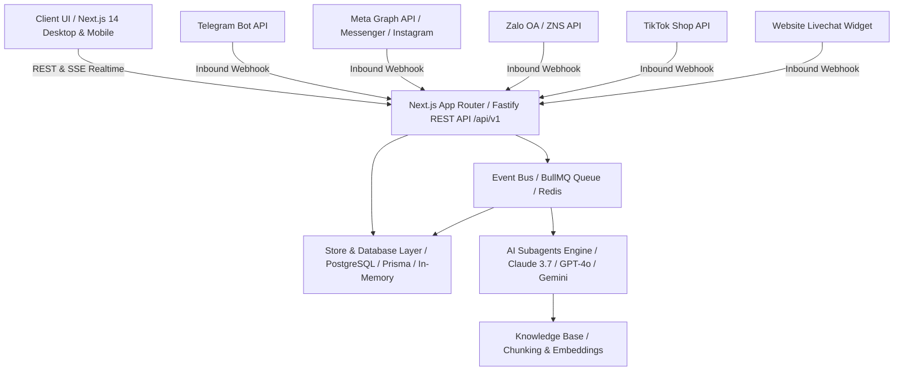

# HAITECH CRM — Kiến Trúc Hệ Thống (Architecture Blueprint)

## 1. Tổng quan kiến trúc

HAITECH CRM được thiết kế theo kiến trúc **Event-Driven Omnichannel & AI Micro-Modular Architecture**, tối ưu hóa cho tốc độ phản hồi real-time, khả năng mở rộng hàng triệu hội thoại đa nền tảng và tích hợp sâu trí tuệ nhân tạo (LLM Subagents).

---

## 2. Bố cục giao diện 3 cột chuẩn Omnichannel

Hệ thống kế thừa và hiện đại hóa giao diện 3 vùng theo nguyên mẫu thực tế:

1. **Thanh điều hướng biểu tượng (Left Sidebar ~104px):**
   - Logo HAITECH CRM (`#145A4A` & `#2E8B72`).
   - Tổng quan, Hộp thư (badge số tin chưa đọc), Tương tác, Khách, Pipeline, Subagent, Kiến thức, Nhắc việc, Kênh, Cài đặt.
2. **Cột danh sách hội thoại (Middle Column ~440px):**
   - Ô tìm kiếm toàn văn "Tìm tên, SĐT, nội dung...".
   - Bộ lọc kênh dạng pill chips: Tất cả, Chat website, Facebook Messenger, Instagram, Telegram, TikTok, Zalo cá nhân, Zalo OA kèm bộ đếm thời gian thực.
   - Tabs: Tất cả, Chưa đọc, Cần bạn, AI đang trực.
   - Danh thiếp hội thoại: avatar, nhãn kênh, tóm tắt tin mới nhất, nhãn AI, nhãn Nhóm, thời gian tương đối.
3. **Khung hội thoại trung tâm (Center Thread View):**
   - Tiêu đề khách/nhóm, công tắc "AI tự trả lời", chọn "Tự điều phối", trạng thái mở/đóng.
   - Banner cảnh báo minh bạch khi thiếu API key: *"AI chưa trả lời được vì chưa có Claude API key. Nhập ở Cài đặt."*
   - Tin nhắn phân biệt màu sắc: Nhân viên (`#145A4A`), Khách hàng (trắng viền mảnh), Ghi chú nội bộ (vàng `#FEF3C7`), AI Subagent (xanh ngọc sáng).
   - Thanh công cụ AI Assist Bar: `AI gợi ý`, `Để AI trả lời`, `Ghi chú nội bộ`, `Gửi`.
4. **Bảng hồ sơ & AI trí nhớ khách hàng (Right Panel ~340px):**
   - Hồ sơ: Tên, SĐT, Email, Giai đoạn Pipeline, Thẻ, Ghi chú.
   - AI ghi nhớ về khách: Trích xuất tự động nhu cầu, thói quen, ngân sách từ hội thoại.
   - Nhắc việc & Hẹn lịch chăm sóc: Hạn chót, mức độ ưu tiên, gán chuyên viên.

---

## 3. Quản lý trạng thái & Idempotency

- **Idempotency Key:** Mọi webhook gửi đến đều được kiểm tra `provider_event_id` nhằm chống trùng lặp tin nhắn khi webhook nhà mạng retry.
- **Client Message ID:** Tin nhắn gửi đi từ nhân viên đính kèm UUID client để chống gửi kép (double-send prevention).
- **Store Adapter Pattern:** Tách biệt hoàn toàn giữa `MockChannelAdapter` (chế độ Sandbox Demo) và `ProductionChannelAdapter` (gọi API chính thức của Meta, Telegram, Zalo).
